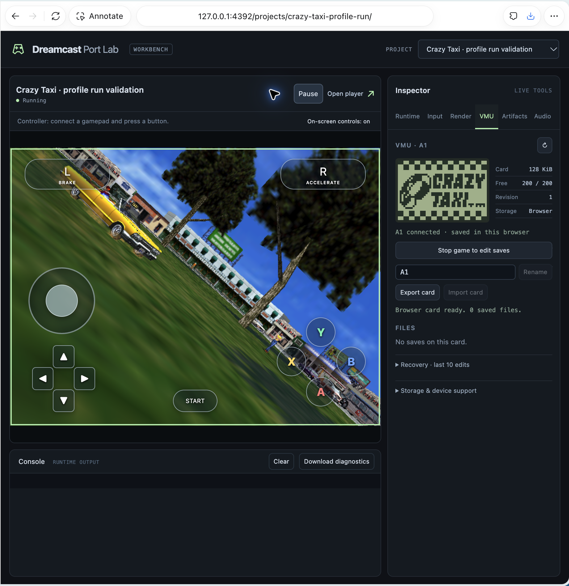

# Dreamcast Port Kit

A **WebGL 2 + WebAssembly port kit for modern browsers**. Bring user-supplied
Dreamcast games to the web with browser rendering, audio, touch and gamepad input.

The pipeline translates SH-4 game code to C/WebAssembly, emulates Dreamcast
hardware support and interprets the ARM7 sound CPU. Each title needs its own
verified profile. **Browser playback is the target**; native executables are
used for diagnostics.

The player requires a modern browser with WebGL 2, WebAssembly, Web Workers and
WebGL OffscreenCanvas support.



## Port Lab

- **Workbench** — game preview, input/render/audio tools and runtime console.
- **Player** — a separate game-only view with keyboard, touch and gamepad support.
- **Projects and artifacts** — switch titles and inspect stage receipts and saved builds.
- **MCP debugger** — typed tools for connecting, inspecting and testing local sessions.

## Quick start

Requires Python 3.10+, Git and `bsdtar`. Native builds need a C11 compiler;
browser builds also need an activated Emscripten SDK. Use your own disc image.

```sh
python3 port.py prepare "/path/to/game.7z" --project /path/to/project
python3 workspace.py add --project /path/to/project --id my-game
python3 port.py bootstrap --toolchain /path/to/dcrecomp
```

Unknown titles produce a `title-profile.json` template. Determine its addresses
and startup behavior from that executable before translating; another title's
profile will not work.

```sh
python3 port.py translate --project /path/to/project --toolchain /path/to/dcrecomp
python3 port.py build-browser --project /path/to/project \
  --toolchain /path/to/dcrecomp --emsdk /path/to/emsdk
python3 serve_browser.py --project /path/to/project --port 4390
```

Open **[the workbench](http://127.0.0.1:4390/)** or
**[the player](http://127.0.0.1:4390/player.html)**. The player starts a fresh
session. Builds and extracted game data stay in the project's ignored `.local/`
folder; a successful build does not establish playable behavior.

## Status and limits

Crazy Taxi is playable in modern browsers, with correct rendering, working
audio and controls. Performance optimization is ongoing. Other titles need
their own profiles and validation.

GDI and supported raw CUE layouts can be imported directly or from 7z/ZIP.
CHD, CDI, scrambled images and WinCE startup need additional adapters.
No game images, BIOS files or extracted assets are included.

## Documentation

- [Projects, build history and artifacts](docs/projects.md)
- [Browser VMU cards and save tools](docs/vmu.md)
- [Connect an MCP debugger](docs/mcp-debugging.md)
- [Porting workflow](skills/dreamcast-port/SKILL.md)
- [Technical reference and development notes](docs/development-notes.md)
- [Validation records](validation/)
- [Licensing and upstream notices](NOTICE.md)
